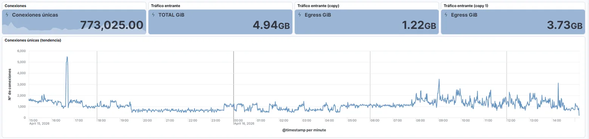
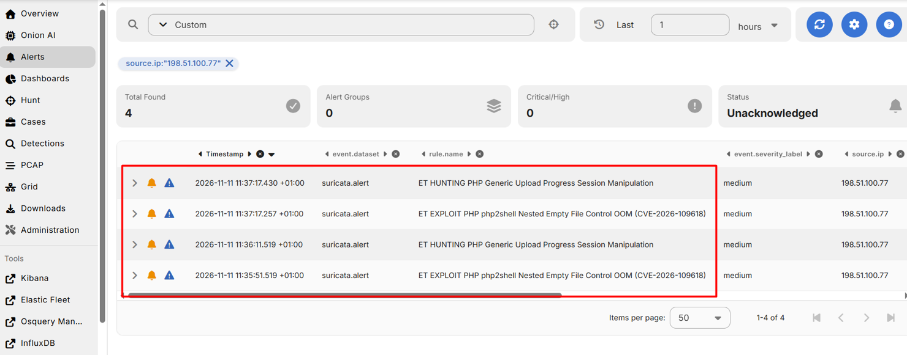
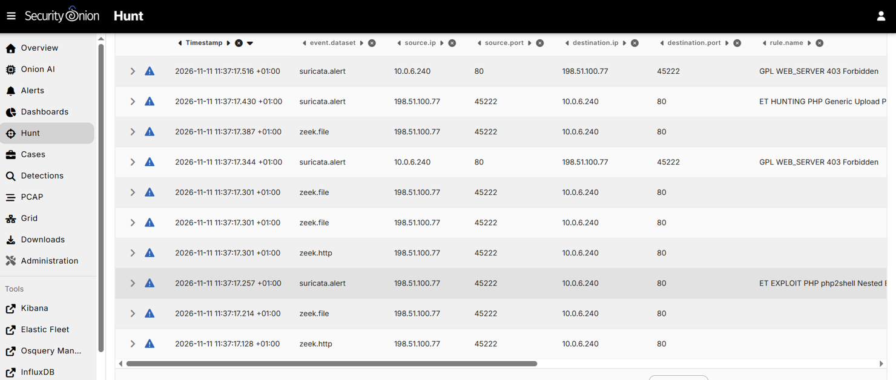
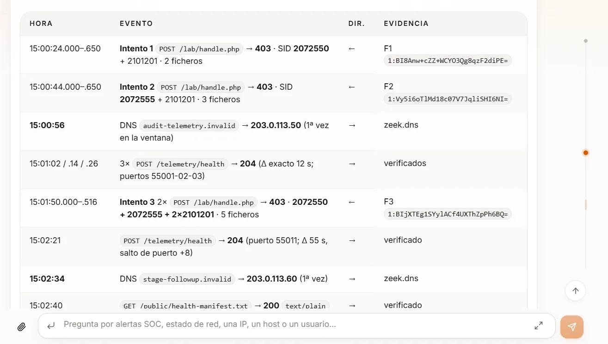
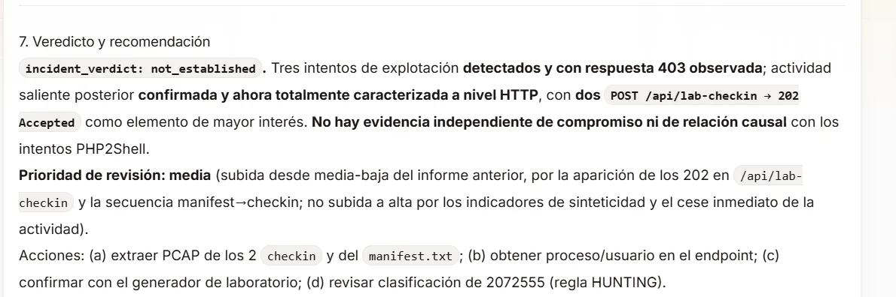
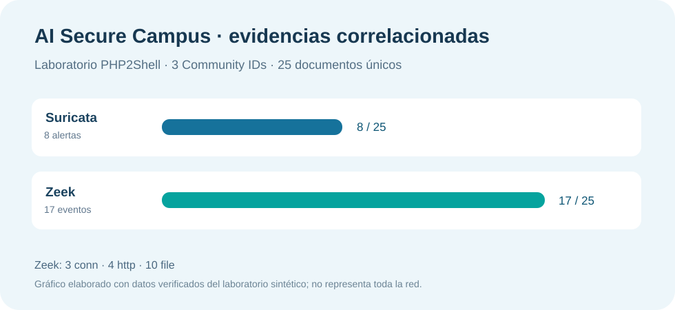

# AI Secure Campus

> **Idiomes:** [Español](../README.md) · **Valencià** · [English](../en/README.md) · [Obrir la web en valencià](./index.html)

**Ciberseguretat, intel·ligència artificial local i investigació d'incidents basada en evidències**

*Centre d'Excel·lència en Intel·ligència Artificial i Big Data · IES Doctor Lluís Simarro (Xàtiva) · PP3.2 — Projecte d'innovació*  
**Versió documental:** 1.0

> **Idea essencial.** AI Secure Campus no substituïx un SIEM, un IDS ni un analista. Integra Security Onion, un conjunt modular d'API de seguretat i un model de llenguatge executat localment perquè el personal tècnic puga formular preguntes, consultar evidències reals, reconstruir cronologies i prendre decisions justificades. La detecció correspon als sensors i a Security Onion; la interpretació contextual i l'ajuda a la investigació són el valor afegit d'AI Secure Campus.

## 1. Resum executiu

AI Secure Campus és una iniciativa d'innovació aplicada del **Projecte Primari 3.2 (PP3.2)** del Centre d'Excel·lència en IA i Big Data de l'IES Doctor Lluís Simarro. Pretén convertir la infraestructura digital de l'institut en un **laboratori viu d'operacions de seguretat (SOC educatiu)** on convergixen l'observabilitat de xarxa, la detecció d'amenaces, l'inventari d'actius, la telemetria dels equips i la intel·ligència artificial local.

El principi de funcionament és clar: **les evidències es consulten en les plataformes especialitzades i arriben al model d'IA mitjançant ferramentes controlades**. El model no és una font de veritat ni necessita accés directe i indiscriminat a les infraestructures. En lloc d'això, demana operacions delimitades a API-SOC, API-Net i API-Endpoint, interpreta els resultats estructurats, distingix els fets de les hipòtesis i identifica riscos i mancances de cobertura.

El projecte s'adreça al personal d'administració de sistemes i seguretat, que necessita investigar incidències; a l'alumnat i professorat de Formació Professional, que pot treballar amb dades reals o sintètiques supervisades; i a altres entitats educatives o professionals que busquen un exemple reproduïble d'integració entre SIEM, API i IA local.

Durant novembre de 2026 s'han validat la correlació Suricata–Zeek, l'agrupació per Community ID, la investigació temporal entre connexions diferents, l'enriquiment opcional de xarxa i la generació d'informes assistits. La plataforma no es presenta com un producte comercial, un SOC autònom ni una ferramenta de resposta automàtica a incidents.

## 2. Encaix en el Projecte d'Excel·lència: PP3.2

Dins de **PP3 — Projectes d'Innovació**, AI Secure Campus correspon a **PP3.2**. Complementa **CENTINELA+ (PP3.1)**, centrat en la sensorització i l'anàlisi del centre intel·ligent, però amb una finalitat pròpia: **aportar seguretat, visibilitat i capacitat d'investigació sobre els servicis, les xarxes i els actius digitals de l'ecosistema educatiu**.

La vinculació amb el Centre d'Excel·lència s'articula en quatre eixos:

- **Innovació tecnològica:** integració de sensors de seguretat, anàlisi de dades, microservicis i models de llenguatge locals amb ferramentes.
- **Innovació metodològica:** aprenentatge basat en reptes SOC, resolució d'incidents, anàlisi forense de xarxa i treball amb evidències.
- **Transferència i replicabilitat:** contractes API documentats, components independents i proves reproduïbles en altres centres.
- **Govern responsable:** control institucional de les dades, interpretació explicable, revisió humana i divulgació rigorosa dels resultats.

El plantejament inicial de PP3.2 també preveia **xarxes neuronals d'impulsos (SNN), analítica predictiva i MLOps**. Continuen sent possibles línies d'investigació, però **el nucli operatiu documentat és l'assistent SOC amb IA local que aprofita les dades de Security Onion**. No s'afirma que existisca un detector neuromòrfic productiu ni un cicle complet de MLOps predictiu desplegat.

## 3. Problema i objectius

Una infraestructura educativa moderna combina aules, VLAN, equips d'usuari, sistemes de gestió, servidors, dispositius connectats i servicis interns. El volum de telemetria fa poc eficient revisar manualment i de manera aïllada cada registre. Una firma IDS pot generar una alerta, però cal saber qui es comunica amb qui, quan, amb quin protocol, quina resposta retorna el servici i quina activitat apareix al voltant.

L'objectiu és **reduir el temps entre la detecció d'un senyal i una hipòtesi verificable**:

1. Centralitzar l'observació sense substituir les ferramentes especialitzades.
2. Prioritzar alertes segons **severitat original, significat de la firma i cobertura de la consulta**.
3. Relacionar registres de fonts diferents sense confondre proximitat temporal amb causalitat.
4. Enriquir les investigacions amb informació de xarxa i d'equip quan estiga disponible.
5. Permetre la investigació en llenguatge natural amb referències, límits i supervisió humana.
6. Convertir els avanços tècnics en materials reutilitzables per a la formació i la transferència.

### 3.1 Què fa i què no fa

| Capacitat | Responsabilitat descrita |
|---|---|
| Detecció de firmes i registre de trànsit | **Security Onion, Suricata i Zeek**, no l'LLM per si mateix. |
| Triatge i classificació d'alertes | **API-SOC**, amb categories, prioritats, recomptes i avisos de cobertura. |
| Investigació per flux | **API-SOC**, amb Community ID i altres relacions justificades. |
| Investigació d'activitat de xarxa | **API-SOC /analysis/**, per període, equip, domini i connexió. |
| Context de VLAN i ubicació | **API-Net**, si les dades i els permisos ho permeten. |
| Processos i context del sistema | **Elastic Agent + API-Endpoint**, amb telemetria pertinent. |
| Explicacions i recomanacions | **Qwen local**, basat en les ferramentes i en la incertesa explícita. |
| Bloquejos o modificacions de tallafoc sense aprovació | **No formen part del mode operatiu validat**. |

## 4. Principis arquitectònics

- **Especialització:** Security Onion és la referència de trànsit i IDS; API-Net d'inventari de xarxa; API-Endpoint de telemetria dels equips.
- **Modularitat:** les tres API tenen contractes separats i poden evolucionar de manera independent.
- **Accés controlat:** el model no necessita credencials d'Elasticsearch ni administració directa de RouterOS.
- **Investigació de només lectura:** el flux actual consulta dades i no executa remediacions automàtiques.
- **Evidència abans que relat:** el document d'origen, el timestamp i els identificadors de correlació són imprescindibles.
- **Incertesa explícita:** «no observat», «no recuperat», «sense cobertura» i «no demostrat» tenen significats diferents.
- **Processament local:** l'anàlisi principal pot quedar dins de la infraestructura institucional, amb les garanties corresponents.
- **Seguretat per capes:** segmentació, protecció de credencials, controls perimetrals, registre d'accessos i autorització per usuari com a evolució.

## 5. Arquitectura d'AI Secure Campus

La solució s'estructura en **cinc capes**, des de la infraestructura del centre fins a la decisió de l'analista.

<!-- ARCH-DIAGRAM -->

### 5.1 Capa 1: xarxes i actius del centre

La xarxa institucional separa usuaris, servicis i dispositius mitjançant segments i VLAN. La infraestructura MikroTik i les polítiques de filtratge gestionen la connectivitat; els punts monitorats aporten el trànsit utilitzat en les investigacions. Els equips terminals poden afegir dades quan disposen d'agents i integracions adequats.

La representació pública omet adreces d'administració, credencials, interfícies de gestió i detalls que podrien exposar actius sensibles. Les instruccions de desplegament es mantenen en documentació interna.

### 5.2 Capa 2: monitoratge distribuït amb Security Onion

La instal·lació utilitza **Security Onion 3.4.0** amb un node **manager-search** i **dos sensors de xarxa**. Els sensors observen el trànsit i generen deteccions; manager-search proporciona indexació, cerca centralitzada i consola. La distribució separa l'observació de paquets de la investigació, dins dels recursos disponibles.

| Element | Responsabilitat |
|---|---|
| **Sensors de xarxa** | Observar el trànsit visible, executar Suricata i Zeek i proporcionar PCAP quan estiga configurat. |
| **Manager-search** | Gestió, indexació i cerques en Elasticsearch, així com accés central a Security Onion. |
| **Consola de Security Onion** | Vistes **Alerts, Hunt, Correlate, Cases, Detections i PCAP**, entre altres. |
| **Fonts d'endpoint** | Esdeveniments dels equips arreplegats mitjançant agents quan hi ha cobertura. |

Un manager-search combina funcions de gestió i cerca; en instal·lacions majors podrien separar-se en nodes específics.

**Panell d'observabilitat de Security Onion.** Vista històrica de connexions i volum de trànsit. Estes mètriques il·lustren el monitoratge continu i **no corresponen als PCAP sintètics PHP2Shell**.

**Captura real de Security Onion — Alerts.** Quatre deteccions sintètiques inicials de PHP2Shell abans d'incorporar les evidències Zeek.

### 5.3 Capa 3: servicis API especialitzats

Les API formen una **passarel·la d'investigació controlada** entre els sistemes d'evidències i els clients d'IA:

- **API-SOC:** contenidor FastAPI en el servidor **Tità**. Consulta Security Onion/Elasticsearch amb operacions de només lectura i retorna resums, alertes, correlacions i evidències traçables.
- **API-Endpoint:** servici independent en **Tità** que consulta telemetria disponible dels equips.
- **API-Net:** desplegada en la **zona de gestió de xarxa**, separada de Tità i dels sensors, per a consultar MikroTik, VLAN, inventari i localització.

Cap API substituïx la plataforma que subministra les dades. Cada una exposa funcions delimitades.

### 5.4 Capa 4: IA local i orquestració de ferramentes

Un **model Qwen local** s'executa en Tità i fa servir ferramentes estructurades. Davant d'una pregunta, selecciona una operació API, interpreta el JSON, avalua les evidències i redacta una explicació amb referències. Les investigacions complexes poden passar d'una regla a un equip i d'eixe equip a diverses connexions.

El model **no és el detector Suricata, ni el motor de consulta Elasticsearch, ni una font independent de telemetria**. Els contractes de ferramentes delimiten les operacions i les instruccions impedixen inventar processos, usuaris, ubicacions, remediacions o incidents confirmats.

La inferència local afavorix el control institucional de les dades i l'autonomia tecnològica. La versió exacta de Qwen i la interfície poden evolucionar sense alterar l'arquitectura.

### 5.5 Capa 5: revisió i decisió humana

L'**analista SOC** contrasta les conclusions amb les plataformes originals i decidix si amplia la cerca, demana evidències, obri un cas, revisa una configuració o tanca una prova sintètica. La redacció del model no té autoritat automàtica. El mateix flux genera informes i materials didàctics.

## 6. Flux complet de dades

El recorregut habitual és:

**Trànsit de xarxa → sensor → Suricata/Zeek → esdeveniments normalitzats → Elasticsearch → API-SOC → ferramenta de l'assistent → Qwen local → analista.**

1. Un dispositiu inicia o rep una comunicació.
2. Un sensor amb visibilitat genera evidències: **Suricata** detecta coincidències de firmes; **Zeek** registra connexions, DNS, HTTP, TLS, fitxers i altres protocols.
3. Security Onion ingestix i indexa els registres amb marques temporals, datasets i atributs de xarxa.
4. API-SOC fa consultes acotades per període, SID, IP, domini o Community ID. **No accepta DSL arbitrari d'Elasticsearch enviat per qui fa la petició**.
5. El backend retorna evidències estructurades, recomptes i avisos de camps absents o cobertura parcial.
6. Qwen interpreta els resultats i pot demanar consultes addicionals.
7. L'analista verifica les referències i determina els passos següents.

### 6.1 Model d'evidències

Els camps rellevants inclouen **@timestamp, event.dataset, source.ip, source.port, destination.ip, destination.port, network.transport, network.community_id, rule.name, rule.uuid, http.*, dns.*** i, quan existixen, identificadors de Zeek com **log.id.uid** i metadades de fitxers.

**Community ID** ajuda a vincular observacions d'un mateix flux registrades per ferramentes distintes. **No identifica una transacció HTTP concreta ni assegura que totes les observacions siguen una sessió TCP única**. El UID de Zeek pot relacionar registres Zeek, però no s'ha d'equiparar automàticament a un camp semblant de Suricata. La proximitat temporal tampoc demostra causalitat.

## 7. API-SOC: nucli d'investigació i anàlisi

API-SOC utilitza **Python, FastAPI i contractes HTTP/OpenAPI**. Consulta les dades de Security Onion amb credencials de servici, paràmetres validats i camps restringits. Abstrau els índexs del SIEM per als programes, els analistes i l'assistent local.

| Família funcional | Exemples de ruta | Finalitat |
|---|---|---|
| Salut | /health | Disponibilitat de l'API. |
| Resum SOC | /soc/summary, /soc/critical | Indicadors agregats i alertes destacades. |
| Priorització | /soc/critical/detect, /soc/critical/workflow | Classificació i guia de triatge. |
| Triatge ràpid | /soc/triage/fast | Recomptes fiables de firmes i llistes compactes de prioritats. |
| Context de regla | /soc/alerts/by-rule | Orígens, destinacions i cronologia d'un SID. |
| Investigació inicial | /soc/alerts/investigate | Suricata amb Zeek conn/http i confiança de l'enllaç. |
| Correlació ampliada | /soc/alerts/correlate | Datasets de Suricata/Zeek agrupats per Community ID. |
| Analítica de xarxa | /analysis/ | Anàlisi d'equips, dominis, trànsit i cronologia. |
| Informes | /soc/report/json, /soc/report/html, /soc/report/markdown | Resultats estructurats i compartibles. |

Són contractes de programari reals, però no garantixen que tots els datasets estiguen sempre disponibles.

### 7.1 Fast Triage: no ocultar firmes poc freqüents

**/soc/triage/fast** resol una limitació típica dels llistats Top-N: les firmes informatives de gran volum poden ocultar deteccions menys freqüents però importants. Utilitza **agregacions composite paginades** per firma i SID, diferencia la severitat original de la classificació semàntica i manté llistes independents de firmes freqüents, de severitat alta i de prioritat.

Inclou finestres UTC explícites, límits de paginació, indicadors **partial_results**, recomptes separats de severitats i categories, avisos de dades absents i telemetria de duració. El primer triatge no necessita consultar lentament l'inventari ni API-Endpoint.

Proporciona una orientació inicial ràpida i reproduïble, no una declaració de compromís a partir d'una alerta P2.

### 7.2 Classificador semàntic de firmes

Un mòdul Python compartit avalua prefixos, termes significatius i regles de priorització.

| Classificació | Interpretació operativa |
|---|---|
| **critical_or_high_risk** | Firma de risc elevat que requerix context i revisió prioritària. |
| **security_relevant** | Senyal de seguretat, encara que la severitat original no siga crítica. |
| **context_review** | Necessita correlació, rol de l'equip i context temporal. |
| **informational** | Telemetria habitual o informativa que pot importar segons el context. |
| **unclassified** | Classificació insuficient; no es descarta silenciosament. |

**La severitat original, la classe semàntica i la prioritat d'investigació són conceptes diferents.** Una detecció HTTP 403 pot ser contextual, i una firma EXPLOIT o HUNTING no acredita per si mateixa una explotació reeixida.

### 7.3 Context d'un SID o una regla

**/soc/alerts/by-rule** permet saber «quins equips generen esta firma?» o «quines destinacions són les més habituals?». Admet noms exactes o SID, filtres temporals, agrupació per origen/destinació, mostres acotades i enriquiment opcional. Els totals provenen d'Elasticsearch, **no** només dels buckets visibles. També assenyala IP absents, consultes parcials i errors d'enriquiment.

### 7.4 Investigació Suricata–Zeek

**/soc/alerts/investigate** partix d'una alerta i recupera esdeveniments pròxims de **zeek.conn** i **zeek.http**. Prioritza **network.community_id**, la 5-tupla i la proximitat temporal; si falten identificadors, pot aplicar una coincidència acotada de 5-tupla i temps. Declara el mètode de correlació, la confiança i el veredicte inicial **not_established**.

**Captura de Security Onion Hunt.** La correlació reunix registres diferents de Suricata i Zeek relacionats amb un flux observat.

### 7.5 Correlació ampliada i resposta optimitzada per a la IA

**/soc/alerts/correlate** accepta diversos SID o un Community ID i consulta els datasets permesos: **suricata.alert, zeek.conn, zeek.http, zeek.file, zeek.ssl, zeek.dns i zeek.quic**. Alguns esdeveniments de fitxers Zeek sense Community ID es poden enllaçar per un UID de Zeek vàlid i temporalment pròxim, sense confondre'l amb un UID de Suricata.

Els documents s'agrupen per Community ID i s'eliminen duplicats segons índex i identificador. Les dues vistes mantenen cobertura i avisos:

- **view=full:** detalls individuals de cada evidència per a auditoria i compatibilitat.
- **view=summary:** resum compacte per flux de firmes, transaccions HTTP i metadades de fitxers; conserva les referències amb **evidence_index_catalog** i **evidence_refs**.

Això reduïx el context redundant que rep Qwen sense canviar les cerques. Un esdeveniment zeek.file o una resposta HTTP 403 no demostren execució, compromís ni bloqueig efectiu.

### 7.6 Informes i presentació de resultats

Els informes JSON, HTML i Markdown servixen per a arxivar evidències, compartir resums tècnics i crear pràctiques. Han de separar recomptes verificables, interpretacions, hipòtesis, recomanacions i límits. La redacció d'IA no és una acta formal d'incident sense revisió professional.

## 8. Motor d'anàlisi de l'activitat de xarxa

Les ferramentes **/analysis/** responen preguntes més enllà de les firmes IDS: quins dominis resol un equip, quines connexions inicia, quins protocols apareixen, si hi ha periodicitat, amb quina confiança s'atribuïx un servici i què canvia al voltant d'una alerta.

Les fonts principals són **Zeek DNS, Conn, HTTP, SSL/TLS i QUIC**, amb Suricata i context de xarxa opcionals. La classificació de servicis s'aplica **després del descobriment** i manté visibles els dominis desconeguts.

### 8.1 Funcions disponibles

| Funció | Explicació |
|---|---|
| Descobriment de dominis | Llista noms consultats per una IP o xarxa en una finestra temporal. |
| Investigació d'equip | Resumeix dominis, servicis i sessions d'una IP. |
| Cronologia | Ordena DNS, connexions, HTTP, TLS, QUIC i alertes relacionades. |
| Connexions externes | Resumeix destinacions públiques, protocols, ports i bytes observats. |
| Servicis i categories | Reconeix possibles actualitzacions, telemetria, IA i altres famílies. |
| Anomalies explicables | Descriu periodicitat i ràtios connexió/DNS sense atribuir intenció maliciosa. |
| Atribució DNS–connexió | Diferencia resolució, connexió candidata i corroboració amb HTTP Host o TLS SNI. |
| Enriquiment opcional | Afig VLAN o ubicació d'actius amb API-Net i indicadors de confiança. |

### 8.2 Nivells d'evidència

- **OBSERVED:** consulta o resolució DNS observada; no acredita connexió posterior.
- **CONNECTED:** connexió compatible a una IP resolta dins de la finestra; l'atribució encara pot ser provisional.
- **CONFIRMED:** un HTTP Host, un TLS SNI o un nom QUIC corrobora la relació amb el domini.
- **ATTRIBUTED / USER_ATTRIBUTED:** estats reservats per a evidència suficient de procés/usuari d'endpoint.

Els DNS compartits, les CDN i les coincidències temporals poden produir associacions febles. L'API ha d'exposar confiança i estats desconeguts.

### 8.3 Finestres temporals i cobertura

Les consultes utilitzen finestres explícites, gestió coherent d'UTC, deduplicació de consultes DNS lògiques, regles d'agrupació de sessions i límits de volum. Els camps inexistents o els resultats truncats s'han d'indicar. Els PCAP docents utilitzen **finestres absolutes UTC** per a fer comparacions reproduïbles.

## 9. API-Net: context de la infraestructura de xarxa

API-Net connecta la investigació de seguretat amb la **topologia lògica i física de la xarxa**. Funciona en la **zona de gestió**, separada de Tità i dels sensors de Security Onion. Consulta xarxes, VLAN, passarel·les i, si hi ha inventari suficient, equips MikroTik, MAC, commutadors i ports.

L'analista pot preguntar: a quina VLAN i subxarxa pertany una IP? Hi ha coincidència amb l'inventari? Es pot relacionar amb una MAC i un port d'accés? És un port troncal, que impedix assegurar la ubicació física? Què s'ha verificat i què s'ha inferit únicament del CIDR?

L'enriquiment és opcional perquè les consultes profundes a equips de xarxa poden tardar molt més que una agregació d'Elasticsearch. Es diferencien la consulta ràpida de VLAN i la localització detallada. Sense evidència física suficient, rack, switch, port i MAC han de figurar com a desconeguts o amb confiança baixa.

Els tallafocs MikroTik i les polítiques de segmentació continuen administrant-se independentment. **L'assistent no té validada la modificació autònoma de regles de tallafoc.** Qualsevol evolució exigiria identitat, autorització granular, aprovació humana, auditoria i reversibilitat.

## 10. API-Endpoint: visibilitat dels equips amb Elastic Agent

La telemetria de xarxa permet observar **quins equips es comuniquen, quan, amb qui i mitjançant quins protocols**, però no sempre revela **quin procés ha iniciat la connexió, quin usuari estava actiu ni què ha passat dins del sistema operatiu**.

**API-Endpoint és útil perquè consulta i enriquix les dades arreplegades per Elastic Agent en els equips instrumentats.** Elastic Agent recopila la informació autoritzada, Security Onion la ingestix i indexa, i API-Endpoint oferix el context a AI Secure Campus. El servici s'executa en **Tità**.

### 10.1 Elastic Agent com a font d'observabilitat de l'equip

**Elastic Agent** és l'agent unificat utilitzat amb Security Onion per a recopilar esdeveniments autoritzats en equips Windows, Linux i macOS compatibles. A diferència de Suricata i Zeek, que inspeccionen trànsit observat pels sensors, pot aportar informació interna del sistema.

Segons les polítiques i les integracions actives, pot proporcionar:

- **Inventari:** identitat, sistema operatiu, estat de l'agent i atributs del dispositiu.
- **Processos:** creació, finalització, executables, arguments i processos pare.
- **Xarxa de l'endpoint:** connexions i, quan es registra, procés responsable i destinació.
- **Fitxers:** operacions i metadades seleccionades.
- **Seguretat i sistema:** autenticació, servicis i registres Windows/Linux.
- **Osquery Manager:** consultes d'estat de l'equip, si la política ho permet.

**Instal·lar l'agent no activa automàticament totes les classes d'esdeveniments.** La cobertura depén de les integracions, els permisos i la proporcionalitat del tractament de dades.

### 10.2 Gestió amb Elastic Fleet i Security Onion

**Elastic Fleet** gestiona el registre dels agents, les polítiques i el seu estat. Segons la configuració es poden emprar **Elastic Defend, System, Windows i Osquery Manager**.

El recorregut és:

**Equip amb Elastic Agent → política i integracions de Fleet → ingesta en Security Onion → Elasticsearch → API-Endpoint → assistent AI Secure Campus.**

API-Endpoint no substituïx els agents, no instal·la sensors i no deduïx processos a partir d'una captura de paquets.

### 10.3 API-Endpoint durant una investigació

| Pregunta de l'analista | Evidència necessària | Precaució |
|---|---|---|
| Quin equip tenia esta IP? | Identitat i inventari de l'agent | La IP pot canviar: cal comprovar la data. |
| L'agent està actiu? | Estat Fleet i política | Estar registrat no significa recopilar tots els tipus de registre. |
| Quin procés va obrir la connexió? | Esdeveniments de xarxa associats a procés | Cal hora, identitat i destinació correlacionables. |
| Es va iniciar un procés sospitós? | Telemetria de processos | Una alerta IDS no demostra execució. |
| Es van escriure fitxers al disc? | Esdeveniments locals de fitxers | **zeek.file** són metadades de trànsit, no prova d'escriptura. |
| Quin usuari hi estava implicat? | Esdeveniments autenticats i de procés | Atribuir només amb evidències suficients. |

### 10.4 Correlació del trànsit amb l'endpoint

La investigació ideal combina **Suricata** per a la detecció, **Zeek** per al context de xarxa i **Elastic Agent** per a l'activitat local. Si després d'una alerta web apareix una connexió salint, els esdeveniments de procés de l'endpoint poden ajudar a verificar la relació. Calen timestamps i destinacions reals; compartir IP o domini no és suficient.

**Limitació actual:** API-Endpoint i les consultes de context existixen, però l'atribució concloent d'un flux a un procés/usuari requerix un contracte temporal prou complet dels esdeveniments d'Elastic Agent. Sense això, el valor correcte és **desconegut**.

### 10.5 Cobertura, equips sense agent i laboratoris

Un equip instrumentat amb telemetria pertinent permet investigar l'activitat local. Un equip inventariat sense registres coincidents pot identificar-se, però no vincular-se a una execució. Un dispositiu sense Elastic Agent —o una IP fictícia d'un PCAP— no pot aportar processos reals atribuïbles.

L'evolució consistix a ampliar de manera controlada la cobertura i la qualitat dels registres, sense convertir hipòtesis en compromisos confirmats. Consulteu la [guia d'Elastic Agent](https://docs.securityonion.net/en/3/main/elastic-agent/) i la [guia d'Elastic Fleet](https://docs.securityonion.net/en/3/main/elastic-fleet/) de Security Onion.

## 11. Qwen: investigació de seguretat assistida per ferramentes

Qwen local és la **capa d'interacció**. Convertix preguntes en crides delimitades a ferramentes i interpreta registres reals, en lloc de generar explicacions genèriques sense base.

### 11.1 Cicle d'una consulta

1. L'operador pregunta què ha passat amb un SID o equip.
2. Qwen selecciona **soc_triage_fast**, **soc_rule_context**, **soc_alert_correlate** o una altra ferramenta.
3. L'API valida la regla, la IP, les dates, la vista o el Community ID.
4. La ferramenta retorna evidències, cobertura, avisos i referències.
5. Qwen avalua les dades i pot fer més consultes.
6. L'informe separa **observacions, inferències, absències d'evidència i accions recomanades**.

Combinar correlació per flux amb activitat d'un equip permet investigar **connexions diferents** per identitat i temps. No és una prova automàtica de causalitat.

### 11.2 Salvaguardes d'interpretació

L'assistent no ha de declarar compromís per una coincidència IDS; considerar que HTTP 403 prova un bloqueig efectiu o que HTTP 202 prova execució; suposar que el trànsit periòdic i de poc volum és inofensiu; atribuir un Community ID a una petició exacta; inventar usuaris, processos o actius; ni afirmar cobertura total si només s'ha consultat una part de la xarxa.

Ha de citar índex, identificadors de documents i timestamps, comunicar **partial_results** i les limitacions. Els continguts de logs, URI i noms de fitxers són **dades no fiables**, no instruccions per al model.

### 11.3 Per què aporta valor la IA local

La inferència local reforça el control institucional de la informació de seguretat i oferix experiència formativa en desplegament, quantització, inferència, ferramentes i avaluació. **Allotjar la IA localment no certifica, per si mateix, la privacitat ni la seguretat**: cal controlar permisos, retenció, accessibilitat i integracions.

### 11.4 Errors que ha de detectar l'analista

Un model pot confondre falta de dades amb absència d'activitat, alertes amb compromisos, coincidència temporal amb causalitat i hora local amb UTC. El projecte prova estos errors. La qualitat depén de la correspondència amb els documents i del reconeixement de les incerteses, no de la fluïdesa del text.

## 12. Fluxos d'ús habituals

### 12.1 Supervisió i triatge inicial
Una finestra curta oferix totals prioritzats, severitats originals, categories semàntiques, firmes freqüents, firmes prioritàries i cobertura.

### 12.2 Investigació d'una firma
Un SID permet consultar orígens, destinacions, timestamps i enriquiment opcional de VLAN/endpoint, amb períodes precisos.

### 12.3 Correlació entre Suricata i Zeek
S'analitzen connexions, mètodes HTTP, respostes i fitxers observats. Si dos POST compartixen Community ID, no es pot assignar cada firma a una petició sense una prova addicional.

### 12.4 Investigació temporal de l'equip
Després d'identificar el destí inicial, s'estudien DNS i connexions salints, incloent-hi **altres Community IDs**. La coincidència temporal justifica revisar, però no confirma causalitat.

### 12.5 Documentació i transferència
Els informes reproduïbles es convertixen en casos pràctics, memòries i material per a classe, i permeten comparar Qwen amb les evidències originals.

## 13. Cas pràctic A: PHP2Shell sense compromís demostrat

Un PCAP sintètic controlat reproduïx patrons que activen els SID de Suricata **2072550** i **2072555**. No és un atac real a un servidor institucional. Quatre alertes inicials pertanyen a **tres grups de Community ID**, amb registres addicionals de 403 i de Zeek.

| Indicador validat | Resultat |
|---|---:|
| Alertes PHP2Shell inicials | **4** |
| Grups de Community ID | **3** |
| Alertes Suricata correlacionades, incloent-hi 403 | **8** |
| Esdeveniments zeek.conn | **3** |
| Esdeveniments zeek.http | **4** |
| Esdeveniments zeek.file | **10** |
| Documents d'evidència únics | **25** |
| Truncament de resultats | **No observat** |
| Compromís demostrat | **No** |

El flux més interessant conté **dues firmes i dues peticions HTTP en una mateixa connexió TCP**. La correlació elimina els duplicats correctament. Totes les peticions reben **403 Forbidden**, però això no demostra que no s'haja processat parcialment cap sol·licitud.

**Aprenentatge:** quatre alertes no equivalen a quatre connexions ni, encara menys, a quatre incidents confirmats.

## 14. Cas pràctic B: investigació d'activitat posterior

Un segon PCAP sintètic conserva les firmes inicials i afig esdeveniments posteriors de la mateixa adreça fictícia de servidor. Vol comprovar **si l'assistent descobrix altres fluxos i n'interpreta el comportament**, no declarar una infecció.

### 14.1 Cronologia verificada (UTC)

| Hora UTC | Observació | Interpretació justificada |
|---|---|---|
| 15:00:24–15:01:50 | Tres connexions entrants, quatre POST associats a PHP2Shell, respostes 403. | Detecció observada; resultat no establit. |
| 15:00:56 | Consulta DNS a audit-telemetry.invalid. | Resolució, no prova de visita. |
| 15:01:02, :14, :26 | Tres POST periòdics de telemetria, respostes 204. | Activitat HTTP repetida. |
| 15:02:21 | Quart POST de telemetria, resposta 204. | Nova transacció observada. |
| 15:02:34 | Consulta DNS a stage-followup.invalid. | Resolució posterior del mateix equip. |
| 15:02:40 | GET d'un manifest de prova, resposta 200. | Transferència observada, execució no demostrada. |
| 15:02:52 i 15:03:04 | Dos POST de check-in, resposta 202 Accepted. | Peticions acceptades per a possible processament; C2 no confirmat. |

S'identifiquen **set fluxos HTTP salints** a més dels **tres grups entrants**: deu agrupacions de Community ID d'interés. Qwen va descobrir els dominis i les destinacions mitjançant les ferramentes, sense conéixer-los prèviament.

**AI Secure Campus — cronologia d'investigació.** L'assistent reunix intents PHP2Shell, consultes DNS i comunicacions HTTP en una seqüència verificable. Captura d'un **laboratori sintètic**; la interfície es mostra en castellà.

### 14.2 Interpretació de les respostes HTTP

- **403 Forbidden:** s'observa denegació HTTP; el bloqueig preventiu efectiu no queda provat.
- **204 No Content:** resposta correcta sense cos; no acredita innocuïtat.
- **200 OK:** es rep una resposta; no demostra que el contingut s'haja executat.
- **202 Accepted:** el servidor remot accepta la petició per a possible processament; no prova execució, infecció ni exfiltració.

Els esdeveniments justifiquen investigar, però **la proximitat temporal no establix causalitat**. Les IP externes i els dominis del PCAP són valors reservats per a documentació, no indicadors reals de compromís. El servidor fictici no disposa de processos reals d'Elastic Agent.

### 14.3 Què ha demostrat l'avaluació de Qwen

La primera investigació va descobrir DNS i connexions salints, però va deixar algunes transaccions HTTP sense verificar. Una segona consulta va recuperar **les set transaccions HTTP salints**, incloses les dues respostes 202, i va corregir la hipòtesi anterior.

La lliçó és doble: la integració permet investigar iterativament amb evidències, però **l'exhaustivitat del model s'ha de validar** encara que totes les dades existisquen en Security Onion.

**Veredicte tècnic:** hi ha activitat posterior sintètica observada, però no prova independent de compromís ni de relació causal amb PHP2Shell.

**AI Secure Campus — veredicte i recomanacions.** L'assistent mostra `incident_verdict: not_established`, identifica activitat posterior i proposa comprovacions. La imatge és d'una sessió de demostració en castellà, no d'un compromís real.

## 15. Mètriques, rendiment i validació

**Representació de les evidències.** El gràfic prové dels resultats validats del laboratori sintètic i no és una captura de la interfície de l'assistent.

Les xifres corresponen a **proves concretes**, no a garanties de rendiment per a qualsevol càrrega.

| Indicador | Resultat observat | Abast |
|---|---|---|
| Security Onion | **3.4.0** | Versió validada. |
| Proves automatitzades | **165 superades** | Suite de regressió d'investigació i correlació. |
| Correlació view=summary | **194 ms de mitjana** | Finestra fixa del laboratori PHP2Shell. |
| Correlació view=full | **199 ms de mitjana** | Mateix escenari. |
| Reducció del JSON | **58,8 %** | D'uns 14,5 KB a 6 KB, mantenint 25 referències. |
| Vista predeterminada | **view=full** | Retrocompatibilitat conservada. |
| Triatge ràpid | **uns 76 ms** | Mesura d'una prova anterior diferent. |
| Detector anterior | **uns 1,29 s** | Un altre endpoint i una altra càrrega. |

### 15.1 Què es mesura i què no

La latència de l'API no inclou tot el temps que Qwen tarda a triar ferramentes, processar context, fer consultes i redactar. Els indicadors provenen d'una configuració local i una finestra específica; no representen una taxa d'encerts de detecció ni un rendiment garantit.

## 16. Qualitat del programari, proves i manteniment

El projecte seguix un desenvolupament controlat amb revisió de canvis, proves de regressió automatitzades, desplegament en contenidors i conservació d'una imatge anterior recuperable. Les proves comproven classificació, recomptes exactes, deduplicació, límits, errors HTTP, dates i compatibilitat de les API.

La validació automatitzada no substituïx les proves integrades amb Security Onion real. Els PCAP sintètics permeten comparar els registres esperats amb les evidències que recuperen les API i interpreta Qwen.

### 16.1 Traçabilitat

Un bon informe separa **fets**, **mètodes de correlació**, **inferències**, **incerteses** i **accions recomanades**, i manté identificadors d'índex/document. Els avisos de cobertura i truncament han de ser visibles.

## 17. Seguretat, privacitat i govern de les dades

### 17.1 Separació de privilegis

La investigació operativa és de només lectura. Qwen utilitza contractes de ferramentes en lloc de credencials il·limitades. API-Net queda en la zona de gestió; API-SOC i API-Endpoint són servicis separats de Tità. Ni una web pública ni un client no fiable haurien de tindre accés directe a les API operatives.

### 17.2 Controls necessaris

Cal protegir els servicis amb aïllament de xarxa, credencials controlades, TLS, registres d'accés, mínim privilegi, rotació de secrets i autenticació robusta. **API-SOC no incorpora per si mateixa un sistema complet d'autenticació per usuari i rols d'aplicació**; per això ha de romandre darrere del perímetre de confiança fins a disposar d'una capa d'autorització validada.

Les futures operacions d'escriptura necessitarien permisos granulars, aprovació humana, auditoria i reversió.

### 17.3 Publicació responsable

La documentació pública omet contrasenyes, adreces de gestió, identitats sensibles i esdeveniments de producció crus. Les captures docents han de revisar-se i els casos sintètics han d'estar identificats. La retenció i els accessos queden subjectes a la política institucional.

## 18. Limitacions tècniques i gestió de la incertesa

- **Visibilitat de xarxa:** depén de la ubicació dels sensors, dels protocols, del xifrat i de la capacitat de captura.
- **Cobertura d'endpoint:** depén d'Elastic Agent, la salut del servici i les polítiques.
- **Atribució de processos:** requerix esdeveniments reals de l'agent amb timestamps.
- **Community ID:** és una clau de correlació de flux, no una petició HTTP única ni prova causal.
- **Atribució DNS:** pot ser feble amb resolutors compartits, CDN o destinacions comunes.
- **Índexs incomplets:** parsers i mappings poden deixar camps absents.
- **Anàlisi amb IA:** pot ometre esdeveniments o formular inferències excessivament segures.
- **Consultes profundes d'inventari:** poden ser lentes i són opcionals.

Estos límits formen part de la metodologia: l'alumnat ha de justificar què està demostrat, què queda pendent i per què.

## 19. Impacte educatiu i transferència

AI Secure Campus aporta pràctiques per a **Administració de Sistemes Informàtics en Xarxa (ASIR)**, **Desenvolupament d'Aplicacions Multiplataforma (DAM)** i el **Curs d'Especialització en IA i Big Data**.

| Àmbit | Aplicacions |
|---|---|
| Xarxes i sistemes | VLAN, segmentació, protocols, tallafocs i observabilitat. |
| Ciberseguretat | Monitoratge, Suricata, Zeek, PCAP i investigació amb evidències. |
| Desenvolupament | API REST, FastAPI, OpenAPI, contenidors, validació i CI/CD. |
| Big Data | Elasticsearch, consultes, agregacions, cardinalitat i finestres. |
| IA aplicada | Models locals, ferramentes, raonament amb dades i avaluació d'errors. |
| Ètica i govern | Privacitat, mínim privilegi, incertesa i supervisió humana. |

L'alumnat treballa amb registres observats i preguntes d'investigació, no només amb descripcions teòriques. Pot reproduir consultes, comparar conclusions i proposar millores comprovables.

Per a transferir el projecte a altres centres es pot començar amb un laboratori reduït, contractes API documentats i PCAP sintètics innocus, i incorporar progressivament inventari i telemetria dels equips.

## 20. Full de ruta: operatiu, en millora i exploratori

| Línia | Estat actual | Evolució |
|---|---|---|
| Security Onion distribuït amb dos sensors | **Operatiu i validat** | Millorar retenció i cobertura mesurable. |
| API-SOC, Fast Triage i classificació | **Operatius** | Mètriques periòdiques i rigor interpretatiu. |
| Correlació Community ID Suricata–Zeek | **Operativa i validada** | Relació per transacció quan hi haja evidència. |
| Resum compacte per a Qwen | **Operatiu** | Exhaustivitat en investigacions multietapa. |
| Cronologies DNS/HTTP per equip | **Operatives amb límits** | Mappings i confiança més consistents. |
| Enriquiment API-Net | **Disponible** | Millorar latència i inventari. |
| API-Endpoint | **Integrada; atribució temporal limitada** | Ampliar Elastic Agent i relacionar processos amb connexions. |
| Autenticació i autorització d'API | **Enduriment pendent** | Identitat, RBAC, auditoria i aprovacions. |
| Canvis autònoms de la infraestructura | **No validats** | Accions controlades, reversibles i aprovades. |
| SNN i MLOps predictiu | **Investigació** | Objectius i proves independents del SOC actual. |

La prioritat no és afegir mòduls perquè siguen atractius, sinó millorar **evidència, cobertura, autorització, traçabilitat i utilitat per a l'analista**.

## 21. Preguntes freqüents

### AI Secure Campus substituïx Security Onion?
No. Security Onion aporta monitoratge de paquets i esdeveniments. AI Secure Campus consulta eixes fonts i ajuda a interpretar-les.

### La IA detecta automàticament qualsevol atac?
No. La detecció depén dels sensors, les firmes, els protocols i la telemetria disponible. L'assistent ajuda a classificar i investigar.

### Cada alerta d'explotació és un incident confirmat?
No. Una firma pot detectar un patró sense demostrar execució, persistència o compromís.

### Per què s'utilitza IA local?
Per autonomia tecnològica, control institucional de dades i valor didàctic. El processament local també requerix garanties de privacitat i seguretat.

### Quina diferència hi ha entre «correlacionat» i «confirmat»?
Les observacions correlacionades compartixen un criteri d'enllaç documentat. Confirmar un incident requerix evidències suficients del fet; són conclusions diferents.

### L'alumnat investiga incidents reals de producció?
La plataforma pot generar telemetria institucional, però les pràctiques reproduïbles han d'emprar **captures sintètiques controlades** o dades preparades, amb permisos i protecció de la privacitat.

### Què passa si un equip no té agent?
Es pot investigar el trànsit, però no identificar processos o usuaris únicament a partir d'una connexió.

### Es poden bloquejar dispositius automàticament des del xat?
No és una capacitat operativa validada. Requeriria autorització específica i revisió humana.

## 22. Glossari tècnic

**API-SOC:** interfície de detecció, triatge, correlació i anàlisi basada en Security Onion.  
**API-Net:** interfície d'inventari, VLAN i topologia de xarxa.  
**Elastic Agent:** agent de telemetria d'equips gestionat mitjançant Elastic Fleet.  
**Elastic Fleet:** sistema centralitzat de polítiques, registre i estat dels agents.  
**API-Endpoint:** servici que consulta i contextualitza telemetria dels equips instrumentats.  
**Analista SOC:** professional que valida observacions i decidix investigacions i respostes.  
**Community ID:** identificador de flux per a relacionar registres entre ferramentes.  
**Elasticsearch:** motor de cerca i emmagatzematge d'esdeveniments.  
**Fast Triage:** priorització inicial d'alertes amb cobertura explícita.  
**IDS:** sistema de detecció d'intrusions.  
**LLM:** model de llenguatge de grans dimensions.  
**Manager-search:** node que combina gestió i cerca en Security Onion.  
**OpenAPI:** especificació de contractes HTTP.  
**PCAP:** fitxer de captura de paquets per a anàlisi i proves.  
**SID:** identificador d'una firma Suricata.  
**Suricata:** motor d'anàlisi de xarxa i detecció per firmes.  
**Zeek:** analitzador de xarxa que genera registres estructurats de protocols i fluxos.  
**zeek.file:** metadades de contingut observat en trànsit; no prova d'escriptura local.  
**view=summary:** vista compacta de correlació amb referències d'evidència.  
**SNN:** xarxes neuronals d'impulsos, línia exploratòria.  
**MLOps:** pràctiques de cicle de vida de models d'aprenentatge automàtic.

## 23. Fonts tècniques i revisió editorial

- [Centre d'Excel·lència en IA i Big Data — IES Doctor Lluís Simarro](https://ieslluissimarro.org/projectes/excelencia/index.html)
- [Activitats del Centre d'Excel·lència](https://ieslluissimarro.org/projectes/excelencia/actividades.html)
- [Arquitectura distribuïda de Security Onion](https://docs.securityonion.net/en/3/main/architecture/)
- [Elastic Agent en Security Onion](https://docs.securityonion.net/en/3/main/elastic-agent/)
- [Elastic Fleet en Security Onion](https://docs.securityonion.net/en/3/main/elastic-fleet/)
- Proves dels laboratoris sintètics PHP2Shell A i B validades per l'equip durant novembre de 2026. **No es publiquen credencials, adreces d'administració ni identificadors sensibles de producció.**

**Recomanació editorial:** mantindre dos nivells de documentació: esta **versió pública**, sobre objectius, arquitectura i evidències no sensibles, i un annex operatiu intern amb la topologia exacta, adreces, accessos, secrets i procediments de resposta a incidents. Cal revisar cada captura abans de publicar-la.

---

**IES Doctor Lluís Simarro · Centre d'Excel·lència en Intel·ligència Artificial i Big Data**  
**Projecte Primari 3.2 — AI Secure Campus · Innovació aplicada en ciberseguretat i IA local**

*Esta documentació descriu l'estat tècnic validat a 11 de novembre de 2026 i s'actualitzarà amb l'evolució del projecte.*
